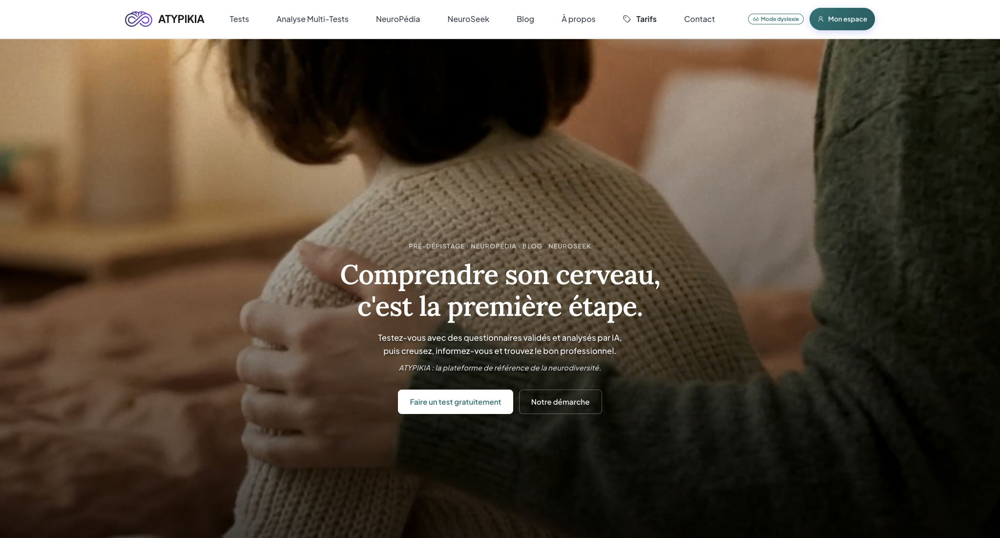
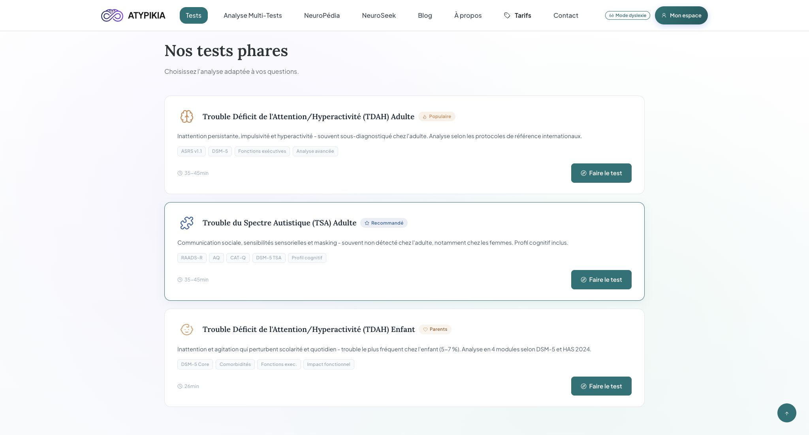

# ATYPIKIA

**Un site de pré-dépistage et d’orientation pour mieux comprendre son fonctionnement et préparer la suite.**

[Découvrir le site ATYPIKIA](https://atypikia.com/)

## Pourquoi j’ai créé ATYPIKIA

J’ai longtemps cherché à comprendre mon propre fonctionnement avant d’obtenir des réponses à l’âge adulte. Il me manquait un point de départ pour mettre des mots sur mon vécu, comprendre les pistes possibles et savoir à qui m’adresser. J’ai créé ATYPIKIA pour rendre cette première étape plus accessible aux personnes qui se posent les mêmes questions et aux parents qui cherchent des repères pour leur enfant.

## Ce que propose le site aujourd’hui

- Des questionnaires de pré-dépistage, notamment autour du TDAH, de l’autisme et d’autres difficultés qui peuvent se recouper.
- Des rapports assistés par IA, avec une lecture accessible pour la personne concernée et, selon le parcours, une version détaillée à partager avec un professionnel. Une synthèse peut aussi rapprocher les résultats de plusieurs questionnaires.
- Des ressources pour approfondir avec l’encyclopédie NeuroPédia et le blog, puis chercher un professionnel ou une association dans l’annuaire NeuroSeek.

Les questionnaires et les rapports servent à explorer des pistes et à préparer un échange avec un professionnel. Le diagnostic relève d’un professionnel de santé qualifié.

## Plusieurs formes d’IA dans un même parcours

Je veux réunir dans le même site des modèles et des méthodes complémentaires. Le calcul des scores suit les règles des questionnaires. Les modèles aident à restituer les résultats, à reformuler un rapport en langage courant ou à faire ressortir les rapprochements entre plusieurs questionnaires. Une recherche documentaire pourrait ensuite apporter des références à consulter. Cette organisation permet de choisir le modèle selon la tâche et de le faire évoluer au fil des évaluations.

## Le choix d’une IA locale et non censurée

J’assume de vouloir explorer des modèles locaux dits « non censurés », capables d’aborder des sujets sensibles de santé mentale sans blocage automatique lié au seul thème de la question. Pour ATYPIKIA, cela va de pair avec des règles de restitution explicites. Les rapports doivent rester fidèles aux réponses, rendre l’incertitude visible et s’en tenir au pré-dépistage.

Le site actuel utilise des API d’IA externes. **Ma priorité est de doter ATYPIKIA de son propre moteur d’IA local**, capable de générer les rapports sans appel à une API externe. À terme, une application locale isolée d’Internet pourrait réunir questionnaires, modèles, ressources et rapports sur un même ordinateur. J’aimerais aussi étudier une version portable sur clé USB, SSD externe ou autre support, selon l’espace disponible et la puissance de la machine.

## Les prochaines évolutions pour les particuliers

1. **Rendre les bilans plus faciles à lire et à utiliser.** Améliorer la lisibilité des rapports personnels, la restitution de plusieurs questionnaires et les repères pour préparer une consultation.
2. **Évaluer le moteur local sur les parcours du site.** Comparer la fidélité aux réponses, la clarté du français et le temps de génération avant d’envisager de remplacer les appels externes.
3. **Étudier un assistant documentaire avec RAG.** L’assistant chercherait des passages dans une sélection de sources vérifiées avant de répondre. Il pourrait aider à comprendre un terme, à s’orienter sur le site ou, dans un espace personnel, à relire un rapport auquel la personne a déjà accès.
4. **Explorer une édition hors ligne et portable.** Vérifier que l’ensemble du parcours peut fonctionner sans Internet et que les données restent sur la machine ou le support choisi.

## Statut du projet

ATYPIKIA est un projet propriétaire à code fermé. Ce dépôt GitHub privé contient la présentation du projet et deux captures du site public. Le code source, les fichiers du site et les données restent privés.

© Fabien EphKa. Tous droits réservés.
